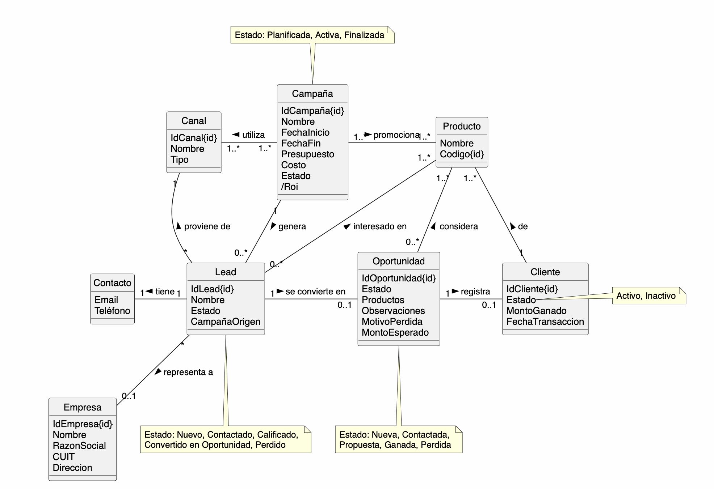

# Modelo de dominio de la tribu

## Alcance del modelo

Modelar el dominio compartido por la tribu a nivel conceptual, sin bajar a tecnología, UI ni base de datos.

## Inputs usados

- `docs/vision/vision-tribu.md`
- `docs/arquitectura/api-integracion.md`
- Historias de usuario de los módulos de Marketing y Ventas.

## Historias priorizadas tomadas como base

### Historias Priorizadas de Marketing

| ID-HU | Recorte que aporta al modelo |
| --- | --- |
| `MKT-HU-06` | Registro de campaña, métricas y asociación con leads |
| `MKT-HU-07` | Gestión del estado del lead |
| `MKT-HU-22` | Registro del canal de origen del lead |
| `MKT-HU-24` | Asociación campaña – lead |
| `MKT-HU-25` | Consulta de catálogos de productos y canales |
| `MKT-HU-26` | Gestión de empresas |

### Historias Priorizadas de Ventas

| ID-HU | Recorte que aporta al modelo |
| --- | --- |
| `VEN-HU-03` | Alta de clientes y oportunidades |
| `VEN-HU-04` | Conversión de leads en oportunidades |
| `VEN-HU-05` | Registro de etapa y motivo de perdida |
| `VEN-HU-09` | Registro de campañas de marketing |

## Clases conceptuales

| Clase conceptual | Evidencia visible | Justificación breve |
| --- | --- | --- |
| `Campaña` | `MKT-HU-06`, minuta 07/05/2026 | representa una acción de marketing medible |
| `Lead` | `MKT-HU-06`, `MKT-HU-07`, `MKT-HU-24`, minuta 07/05/2026 | entidad central de captación con estado intrínseco |
| `Contacto` | Diccionario de datos, minuta 07/05/2026 | agrupa email y teléfono del lead |
| `Canal` | `MKT-HU-06`, `MKT-HU-07`, `MKT-HU-22`, `MKT-HU-24`, `MKT-HU-25`, minuta 07/05/2026 | medio por donde se publicita una campaña (gráfico, radio, etc.); consultable como catálogo |
| `Empresa` | `VEN-HU-04`, `MKT-HU-26`, `docs/descubrimiento/minutas/2026-05-21-minuta-reunion.md` | Es la organización asociada al lead y al cliente; gestionable desde Marketing. |
| `Producto` | `MKT-HU-06`, `MKT-HU-25`, `docs/descubrimiento/minutas/2026-04-23-minuta-marketing-y-campanas.md` | Es el producto que ofrece PSA; consultable como catálogo. |

## Asociaciones

| Relación | Multiplicidad | Sentido de lectura |
| --- | --- | --- |
| `Campaña` → `Canal`       | 1..* a 1..* | Campaña **utiliza** Canal |
| `Campaña` → `Producto`    | 1..* a 1..* | Campaña **promociona** Producto |
| `Campaña` → `Lead`        | 1 a 0..*    | Campaña **genera** Lead |
| `Lead` → `Canal`          | * a 1       | Lead **proviene de** Canal |
| `Lead` → `Contacto`       | 1 a 1       | Lead **tiene** Contacto |
| `Lead` → `Empresa`        | * a 0..1    | Lead **representa a** Empresa |
| `Lead` → `Producto`       | 0..* a 1..* | Lead **interesado en** Producto |
| `Lead` → `Oportunidad`    | 1 a 0..1    | Lead **se convierte en** Oportunidad |
| `Oportunidad` → `Cliente` | 1 a 0..1 | Oportunidad **registra** Cliente |
| `Oportunidad` → `Producto`| 0..* a 1..* | Oportunidad **considera** Producto |
| `Cliente` → `Producto`    | 1 a 1..*    | Cliente **de** Producto |

## Atributos

Anotar los atributos que ayuden a entender el dominio. Si un atributo no aporta claridad, se omite.

| Clase | Identificador | Atributos simples | Atributos derivados |
| --- | --- | --- | --- |
| `Campaña` | IdCampaña | Nombre, FechaInicio, FechaFin, Presupuesto, Costo, Estado | /Roi |
| `Canal` | IdCanal | Nombre, Tipo | - |
| `Cliente` | IdCliente | Estado, FechaTransaccion, MontoGanado | - |
| `Contacto` | - | Email, Teléfono | - |
| `Empresa` | IdEmpresa | Nombre, RazonSocial, CUIT, Direccion | - |
| `Lead` | IdLead | Nombre, Estado, CampañaOrigen | - |
| `Oportunidad` | IdOportunidad | Estado, Productos, Observaciones, MotivoPerdida, MontoEsperado | - |
| `Producto` | Codigo | Nombre | - |

## Notas de dominio

| Clase | Valores de estado |
| --- | --- |
| `Campaña` | Planificada, Activa, Finalizada |
| `Lead` | Nuevo, Contactado, Calificado, Convertido en Oportunidad, Perdido |
| `Oportunidad` | Nueva, Contactada, Propuesta, Ganada, Perdida |
| `Cliente` | Activo, Inactivo |

## Diccionario de datos

### Campaña

| Atributo | Descripción | Tipo | Restricciones | Ejemplo |
| --- | --- | --- | --- | --- |
| IdCampaña | Identificador único de la campaña | Int (id) | Obligatorio, único | `025` |
| Nombre | Nombre descriptivo de la campaña | String | Obligatorio | `Lanzamiento PSA Suite Q2` |
| FechaInicio | Fecha en que comienza la campaña | Date | Obligatorio, ≤ FechaFin | `2026-04-01` |
| FechaFin | Fecha en que finaliza la campaña | Date | Obligatorio, ≥ FechaInicio | `2026-06-30` |
| Presupuesto | Monto planificado para la campaña | Decimal | Obligatorio, > 0 | `150000.00` |
| Costo | Monto efectivamente gastado en la campaña | Decimal | Opcional, ≥ 0 | `132000.00` |
| Estado | Momento del ciclo de vida de la campaña | Enum | Planificada, Activa, Finalizada | `Activa` |
| /Roi | Retorno sobre inversión, calculado como `(MontoGanado - Costo) / Costo` | Decimal derivado | Solo disponible si Costo > 0 | `1.5` |

### Canal

| Atributo | Descripción | Tipo | Restricciones | Ejemplo |
| --- | --- | --- | --- | --- |
| IdCanal | Identificador único del canal | Int (id) | Obligatorio, único | `001` |
| Nombre | Nombre del canal de difusión | String | Obligatorio | `Radio Nacional` |
| Tipo | Categoría del canal | String | Obligatorio | `Radio`, `Gráfico`, `Digital`, `TV` |

### Empresa

| Atributo | Descripción | Tipo | Restricciones | Ejemplo |
| --- | --- | --- | --- | --- |
| IdEmpresa | Identificador único de la empresa | Int (id) | Obligatorio, único | `0042` |
| Nombre | Nombre comercial de la empresa | String | Obligatorio | `Tecno Sur S.A.` |
| RazonSocial | Denominación legal de la empresa | String | Obligatorio | `Tecno Sur Sociedad Anónima` |
| CUIT | Clave Única de Identificación Tributaria | String | Obligatorio, formato XX-XXXXXXXX-X | `30-71234567-8` |
| Direccion | Domicilio fiscal de la empresa | String | Opcional | `Av. Corrientes 1234, CABA` |

### Contacto

| Atributo | Descripción | Tipo | Restricciones | Ejemplo |
| --- | --- | --- | --- | --- |
| Email | Dirección de correo electrónico del lead | String | Obligatorio, formato válido de email | `juan.perez@tecnosur.com` |
| Teléfono | Número de teléfono de contacto del lead | String | Opcional, incluye código de área | `+54 11 4567-8901` |

### Lead

| Atributo | Descripción | Tipo | Restricciones | Ejemplo |
| --- | --- | --- | --- | --- |
| IdLead | Identificador único del lead | Int (id) | Obligatorio, único | `0198` |
| Nombre | Nombre completo del contacto que representa el lead | String | Obligatorio | `Juan Pérez` |
| Estado | Momento del ciclo de vida del lead | Enum | Nuevo, Contactado, Calificado, Convertido en Oportunidad, Perdido | `Calificado` |
| CampañaOrigen | Campaña que originó el primer contacto con este lead | Ref a Campaña | Obligatorio | `CMP-2026-001` |

### Oportunidad

| Atributo | Descripción | Tipo | Restricciones | Ejemplo |
| --- | --- | --- | --- | --- |
| IdOportunidad | Identificador único de la oportunidad | Int (id) | Obligatorio, único | `0055` |
| Estado | Etapa del proceso comercial en que se encuentra la oportunidad | Enum | Nueva, Contactada, Propuesta, Ganada, Perdida | `Propuesta` |
| Productos | Productos considerados en la oportunidad | Ref a Producto (1..*) | Obligatorio | `PSA Field Service` |
| Observaciones | Notas libres del vendedor sobre el seguimiento | String | Opcional | `Cliente solicita demo en julio` |
| MotivoPerdida | Razón por la que se cerró sin conversión | String | Requerido si Estado = Perdida | `Precio fuera de presupuesto` |
| MontoEsperado | Valor estimado del negocio si se cierra ganado | Decimal | Opcional, > 0 | `85000.00` |

### Cliente

| Atributo | Descripción | Tipo | Restricciones | Ejemplo |
| --- | --- | --- | --- | --- |
| IdCliente | Identificador único del cliente | Int (id) | Obligatorio, único | `0011` |
| Estado | Situación comercial actual del cliente | Enum | Activo, Inactivo | `Activo` |
| MontoGanado | Monto total de la transacción cerrada | Decimal | Obligatorio si Estado = Activo, > 0 | `85000.00` |
| FechaTransaccion | Fecha en que se concretó la venta | Date | Obligatorio si Estado = Activo | `2026-05-15` |

### Producto

| Atributo | Descripción | Tipo | Restricciones | Ejemplo |
| --- | --- | --- | --- | --- |
| Codigo | Identificador único del producto | String (id) | Obligatorio, único | `PSA-FS-01` |
| Nombre | Nombre comercial del producto ofrecido por PSA | String | Obligatorio | `PSA Field Service` |

## Diagrama

**Exportación visual del modelo de dominio (`docs/analisis/modelo-dominio.puml`)**

## Trazabilidad

### Desde la visión al modelo

La visión define el problema central de la tribu: Marketing genera leads sin visibilidad sobre su conversión, y Ventas recibe oportunidades sin contexto de origen. La solución es un único flujo que va desde la campaña hasta el cierre comercial, con trazabilidad completa del recorrido.

Ese enunciado se traduce directamente en el modelo:

| Fragmento de visión | Decisión de modelado |
| --- | --- |
| *"Marketing centraliza la creación de campañas, el registro de leads y su asociación a canales y campañas de origen"* | Justifica las clases `Campaña`, `Lead`, `Canal` y las asociaciones `Campaña → Lead` (genera) y `Lead → Canal` (proviene de) |
| *"El lead generado por Marketing y la oportunidad gestionada por Ventas son el mismo objeto en distintas etapas de un único proceso"* | Justifica que `Lead` y `Oportunidad` sean clases separadas pero conectadas mediante `Lead → Oportunidad` (se convierte en), en lugar de unificarlas |
| *"Ventas gestiona oportunidades comerciales, registrando su estado y los motivos de pérdida"* | Justifica los atributos `Estado` y `MotivoPerdida` en `Oportunidad` |
| *"Métricas iniciales de Marketing: leads por campaña, conversión básica de leads y ROI básico por campaña"* | Justifica el atributo derivado `/Roi` en `Campaña` |
| *"Trazabilidad entre campaña de origen y oportunidad comercial resultante"* | Justifica el atributo `CampañaOrigen` en `Lead` y la cadena de asociaciones `Campaña → Lead → Oportunidad` |

### Desde las historias al modelo

Cada clase y asociación del modelo tiene al menos una HU que la justifica:

| Clase / Asociación | HU que la origina | Qué aporta la HU |
| --- | --- | --- |
| `Campaña` + sus atributos | `MKT-HU-06` | Define qué se registra de una campaña y sus métricas asociadas |
| `Lead` + `Estado` | `MKT-HU-07` | Define el ciclo de vida del lead con sus transiciones de estado |
| `Campaña` → `Lead` (genera) | `MKT-HU-24` | Explicita que un lead siempre se origina en una campaña |
| `Lead` → `Canal` (proviene de) | `MKT-HU-22`, `MKT-HU-06`, `MKT-HU-24` | El canal de origen es obligatorio al crear un lead (RN-07), y es insumo para medir efectividad de campañas |
| `Oportunidad` + sus atributos | `VEN-HU-03`, `VEN-HU-05` | Define qué se registra de una oportunidad y cuándo se pierde |
| `Lead` → `Oportunidad` (se convierte en) | `VEN-HU-04` | La conversión del lead es el evento que conecta ambos módulos |
| `Oportunidad` → `Cliente` (registra) | `VEN-HU-03` | El cierre exitoso de una oportunidad produce un cliente |
| `Empresa` + `Contacto` | `VEN-HU-04`, `MKT-HU-06` | El lead representa a una empresa con datos de contacto identificables |
| `Canal` + sus atributos | `MKT-HU-25` | Los canales se consultan como catálogo para asociarlos a campañas y leads |
| `Producto` + sus atributos | `MKT-HU-25` | Los productos se consultan como catálogo y se asocian a campañas y leads |
| `Empresa` + sus atributos | `MKT-HU-26` | Las empresas se gestionan como entidad separada con deduplicación por CUIT |
| `Campaña` → `Producto` (promociona) | `VEN-HU-09`, `MKT-HU-06` | Las campañas se diseñan para productos concretos de PSA |

## Fuera de alcance y exclusiones

- Reportes y estadísticas avanzadas de Ventas (tasa de cierre, pipeline visual, forecasting).
- Automatización de campañas y seguimiento automatizado de leads.
- Integración con herramientas externas (CRM, redes sociales, plataformas de ads).
- Segmentación avanzada de clientes.
- Modelos predictivos o uso de IA.
- Gestión avanzada de permisos y seguridad.
- Interacción directa entre Marketing e Implementaciones.

## Dudas abiertas

- Confirmar el vocabulario común antes de convertir este modelo en su versión viva.
- Definir el tipo del atributo `Codigo` de la entidad `Producto`.